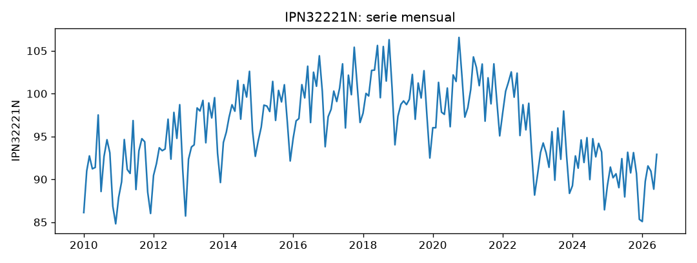
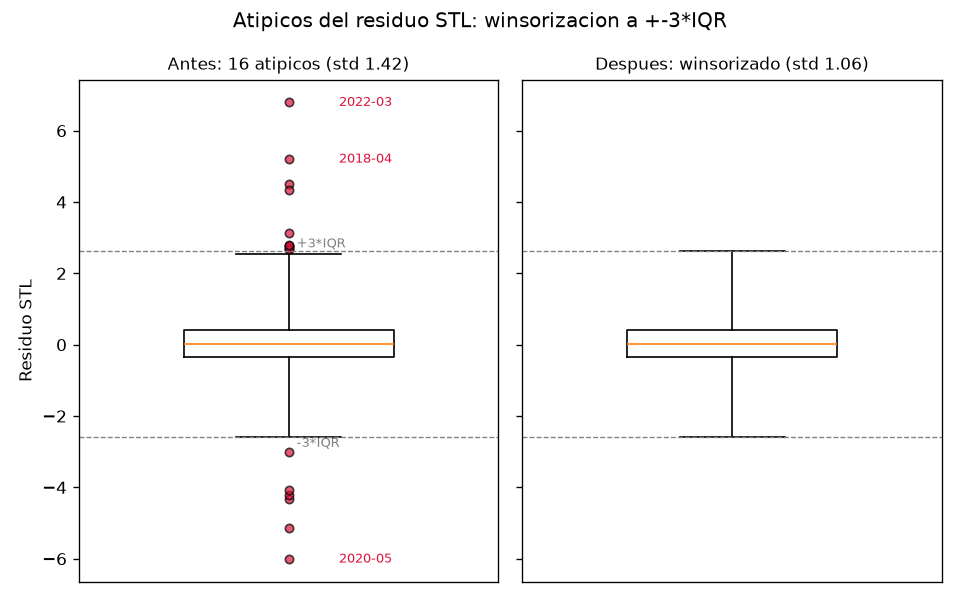
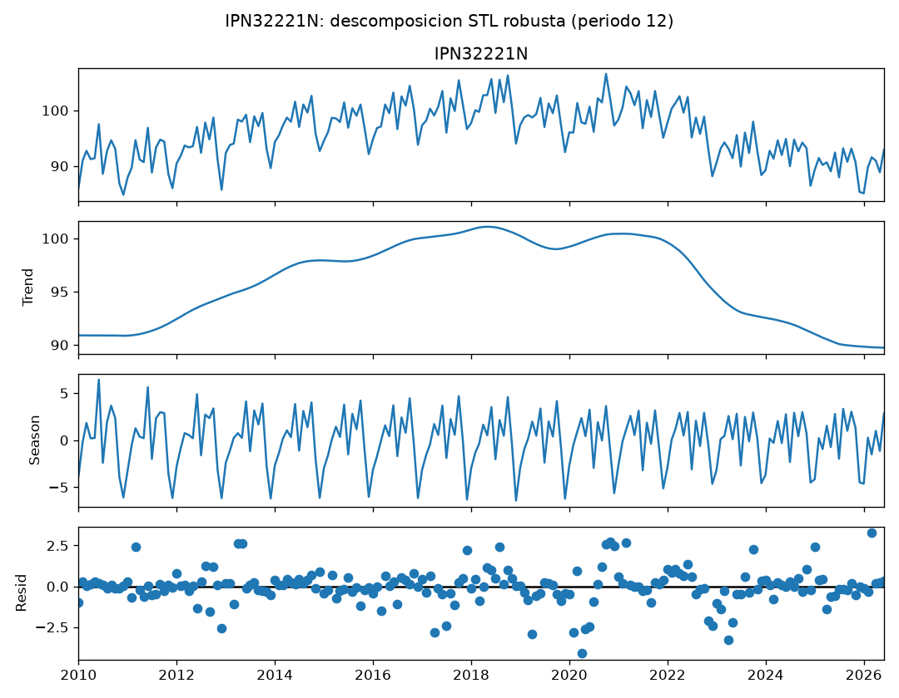
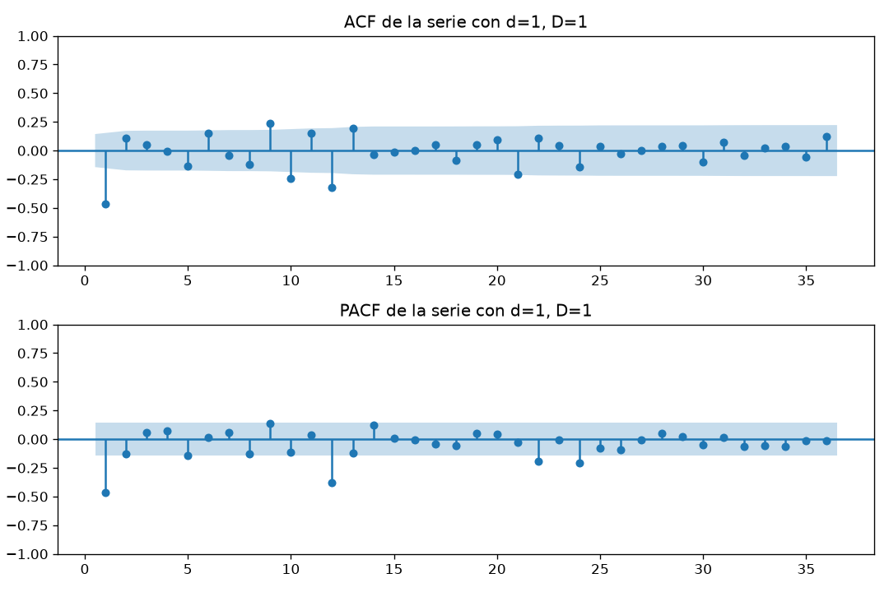
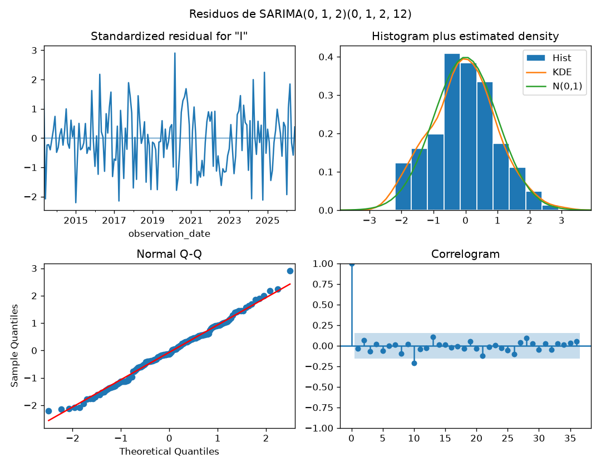

# Informe del miniproyecto 1

Serie **IPN32221N** — Índice de producción industrial de fabricación de cajas
de cartón corrugado y fibra sólida (EE. UU.). Las cifras y figuras de este
informe son las que imprime y genera `python miniproyecto.py`.

## 1. La serie

La serie mide el **índice de producción industrial de la fabricación de cajas
de cartón corrugado y fibra sólida** en EE. UU. (NAICS 32221), con base
2017 = 100 y **sin ajuste estacional**. La publica la Reserva Federal (Board
of Governors of the Federal Reserve System) y se descarga de FRED con el
código [IPN32221N](https://fred.stlouisfed.org/series/IPN32221N); es de
dominio público (obra del Gobierno Federal de EE. UU., *Public Domain:
Citation Requested*). Es **mensual**, va de **2010-01 a 2026-06** con
**198 observaciones** y no tiene meses vacíos. El grupo la eligió porque es la
misma de los talleres, cumple los mínimos (> 60 observaciones, cinco años) y
tiene estacionalidad visible, condición necesaria para la diferencia
estacional y el SARIMA.

**Huecos y datos atípicos.** La serie no tiene huecos (0 NaN), así que no hubo
nada que rellenar. Los valores atípicos no son errores de medición sino dos
**episodios económicos reales**: el desplome de la COVID (abr–jun 2020, con
residuos de hasta $-6$) y el rebote post-pandemia (feb–jun 2022, con residuos
de hasta $+6{,}8$). Estos choques inflan la varianza del residuo y pueden
dominar el ajuste del SARIMA. La decisión fue **winsorizarlos**: ajustar una
STL robusta (periodo 12), calcular el rango intercuartílico $IQR$ de su
residuo y recortar al límite —sin borrar meses— los puntos cuyo residuo se
sale de la banda $[Q_1 - 3\,IQR,\; Q_3 + 3\,IQR] = [-2{,}58,\; +2{,}64]$. Se
winsorizaron **16 puntos**, casi todos de esos dos episodios, conservando la
forma y el número de observaciones. Esta es la columna `decision` de la tabla:
*"Sin huecos; atípicos winsorizados al ±3·IQR del residuo STL (COVID 2020,
rebote 2022)"*.

El $IQR$ se calcula sobre el **residuo de la STL**, no sobre la serie cruda:
así la estacionalidad normal (picos de junio y octubre, valles de diciembre)
no se confunde con datos atípicos. El boxplot compara el residuo **antes y
después** de winsorizar: los 16 puntos fuera de la banda $\pm 3\,IQR$ —entre
ellos 2022-03 ($+6{,}8$), 2018-04 ($+5{,}2$) y 2020-05 ($-6{,}0$)— se recortan
al límite y desaparecen como atípicos; la desviación típica del residuo baja
de $1{,}42$ a $1{,}06$.

## 2. Componentes

La descomposición **STL robusta con periodo 12** muestra:

- **Tendencia:** parte de $90{,}9$ (2010-01), sube a un máximo de $101{,}1$
  (2018-05) y después desciende hasta $89{,}7$ (2026-06). No es monótona:
  crece durante la década y cae tras 2022.
- **Estacional:** el mes más alto es **junio** ($+3{,}74$) y el más bajo
  **diciembre** ($-5{,}67$); octubre también queda alto y enero bajo. El patrón
  es coherente con la fabricación de embalaje: más producción en los meses de
  embalaje previos a las campañas y mínimos en las paradas de fin de año.
- **Residuo:** el más grande en magnitud es **2020-04** ($-4{,}12$), el inicio
  de la COVID, que sigue siendo el choque mayor aun después de winsorizar. La
  desviación típica del residuo es $1{,}07$.

## 3. Líneas base y backtest

El `backtest` común usa **origen móvil sobre los últimos 24 meses** con
horizonte de 1 a 12. Con 198 observaciones hay **13 orígenes** (de 2024-06 a
2025-06): en cada origen el modelo se ajusta solo con los datos **hasta** ese
mes y pronostica los 12 siguientes; las predicciones cubren los últimos 24
meses (2024-07 a 2026-06). Las métricas se promedian sobre los 13 orígenes.
Ningún dato posterior al origen entra al modelo porque cada modelo es una
función `modelo(entrenamiento, h)` que solo ve `entrenamiento`; esto evita la
fuga de información.

Las dos líneas base, en el backtest:

| Modelo | RMSE | MAE | MAPE (%) |
|---|---|---|---|
| estacional ingenuo | 2.17 | 1.88 | 2.09 |
| ingenuo | 3.36 | 2.80 | 3.13 |

Gana el **estacional ingenuo** (RMSE $2{,}17$), como era de esperar en una
serie tan estacional: repetir el mismo mes del año anterior es mucho mejor que
repetir el último valor. Es la línea base a superar.

## 4. Estacionariedad e identificación

Prueba **ADF** (H0: raíz unitaria, es decir, **no** estacionaria; $p < 0{,}05$
indica estacionariedad). En el nivel se usa `regression='c'` —la serie tiene
media distinta de cero pero su tendencia sube y baja, no es una recta
determinista— y se confirma con `'ct'`; en las diferencias también `'c'`
(permite deriva).

| Versión | `regression` | valor $p$ | ¿Estacionaria? |
|---|---|---|---|
| Serie (nivel) | c | 0.508 | No |
| Serie (nivel, con tendencia) | ct | 0.847 | No |
| Diferencia regular ($d=1$) | c | 0.042 | Apenas |
| Diferencia estacional ($D=1$) | c | 0.204 | No |
| Ambas ($d=1,\,D=1$) | c | 0.0001 | Sí |

**Elección: $d=1$, $D=1$.** La estacionalidad es fuerte (fuerza estacional
$F_s = 0{,}79$) y la diferencia estacional baja mucho la varianza
($23{,}4 \to 7{,}3$), lo que justifica $D=1$. Tras la diferencia estacional
aún queda raíz unitaria en la parte regular ($p = 0{,}20$), que desaparece al
añadir la diferencia regular: con ambas, $p = 0{,}0001$ y la varianza es la
mínima ($3{,}42$; con $d=2$ sube a $3{,}64$, señal de no sobre-diferenciar).

Sobre la serie con $d=1,\,D=1$ (bandas $\pm 1{,}96/\sqrt{n} = \pm 0{,}144$):

- **ACF** fuera de banda en los rezagos **1, 6, 9, 10, 11, 12, 13, 21**.
- **PACF** fuera de banda en **1, 12, 22, 24**.

Lo que manda es el **pico estacional en el lag 12** (con satélites en 11 y 13,
típicos de una MA estacional) y la actividad en el **lag 1**. Esto sugiere una
parte regular de orden bajo (MA) y una parte estacional de media móvil; los
satélites alrededor del 12 y la señal en 21–24 anticipan que la MA estacional
puede necesitar orden 2.

## 5. Modelos clásicos

Se comparó por **AIC** una rejilla pequeña de órdenes $(p,q)(P,Q)$ con
$d=1,\,D=1,\,s=12$, con $p\in\{0,1\}$, $q\in\{1,2\}$, $P\in\{0,1\}$,
$Q\in\{1,2\}$ (16 modelos). Los mejores:

| Orden | AIC |
|---|---|
| **(0,1,2)(0,1,2)₁₂** | **549.07** |
| (0,1,2)(1,1,2)₁₂ | 551.01 |
| (1,1,2)(0,1,2)₁₂ | 551.02 |
| (1,1,2)(1,1,2)₁₂ | 552.99 |
| (1,1,1)(0,1,2)₁₂ | 561.99 |

El elegido es **SARIMA(0,1,2)(0,1,2)₁₂**. La mejora grande frente a órdenes con
$Q=1$ (AIC $\approx 615$) confirma la lectura de la ACF: hace falta una **MA
estacional de orden 2**. Su ecuación:

$$(1-B)\,(1-B^{12})\,y_t = (1 + \theta_1 B + \theta_2 B^2)\,(1 + \Theta_1 B^{12} + \Theta_2 B^{24})\,\varepsilon_t$$

**Diagnóstico de residuos (Ljung-Box)**, sobre los residuos estandarizados
descartando el *burn-in* de la diferenciación, con $model\_df = p+q+P+Q$:
$LB(12)\; p = 0{,}014$ y $LB(24)\; p = 0{,}187$. A 24 rezagos no se rechaza la
hipótesis de ruido blanco, pero a 12 rezagos queda una **autocorrelación
marginalmente significativa**. El correlograma y el Q-Q del diagnóstico
muestran residuos casi blancos y aproximadamente normales, con algo de
estructura remanente en el lag estacional, atribuible a los cambios de régimen
(COVID, rebote 2022 y la caída de tendencia posterior) que un SARIMA lineal no
captura del todo.

**Variable exógena.** Se añade el **número de días hábiles de cada mes**
(lunes a viernes, descontando festivos federales de EE. UU.). Es una variable
de **calendario**: depende solo de la fecha, se conoce de antemano para
cualquier mes futuro y por eso **nunca introduce fuga**; en el backtest se usa
`x.loc[entrenamiento.index]` para ajustar y los días hábiles de las fechas
siguientes para pronosticar. El **SARIMAX** mejora al SARIMA solo de forma
marginal (ver tabla): en RMSE empatan en $1{,}63$ y el SARIMAX gana algo en MAE
($1{,}39 \to 1{,}37$) y MAPE ($1{,}53 \to 1{,}51$). La interpretación es que el
SARIMA ya absorbe casi todo el efecto de calendario a través de la
estacionalidad, de modo que los días hábiles aportan poca información nueva.

## 6. Tabla de métricas

`resultados/metricas.csv`, ordenada por RMSE:

| Modelo | Decisión | RMSE | MAE | MAPE (%) |
|---|---|---|---|---|
| SARIMAX(0,1,2)(0,1,2)₁₂ + exógenas | Sin huecos; atípicos winsorizados al ±3·IQR del residuo STL (COVID 2020, rebote 2022) | 1.63 | 1.37 | 1.51 |
| SARIMA(0,1,2)(0,1,2)₁₂ | Sin huecos; atípicos winsorizados al ±3·IQR del residuo STL (COVID 2020, rebote 2022) | 1.63 | 1.39 | 1.53 |
| estacional ingenuo | Sin huecos; atípicos winsorizados al ±3·IQR del residuo STL (COVID 2020, rebote 2022) | 2.17 | 1.88 | 2.09 |
| ingenuo | Sin huecos; atípicos winsorizados al ±3·IQR del residuo STL (COVID 2020, rebote 2022) | 3.36 | 2.80 | 3.13 |

## 7. Conclusión

El mejor modelo clásico es el **SARIMAX(0,1,2)(0,1,2)₁₂ con los días hábiles
del mes** como exógena. Frente a la mejor línea base (el estacional ingenuo)
mejora en las tres métricas:

- **RMSE:** $2{,}17 \to 1{,}63$ ($-24{,}9\%$).
- **MAE:** $1{,}88 \to 1{,}37$ ($-27{,}1\%$).
- **MAPE:** $2{,}09\% \to 1{,}51\%$ ($-27{,}8\%$ relativo).

El SARIMA aporta casi toda la mejora; la exógena de calendario solo añade un
margen pequeño. Donde el modelo sigue fallando es en los **quiebres de
régimen**: la autocorrelación remanente en el lag 12 ($LB(12)\;p=0{,}014$) y el
residuo grande de 2020-04 muestran que los choques bruscos y el cambio de
tendencia tras 2022 no se capturan del todo con un modelo lineal estacional.
Este **SARIMAX(0,1,2)(0,1,2)₁₂ + días hábiles (RMSE 1.63)** es el modelo que el
miniproyecto 2 deberá superar.
